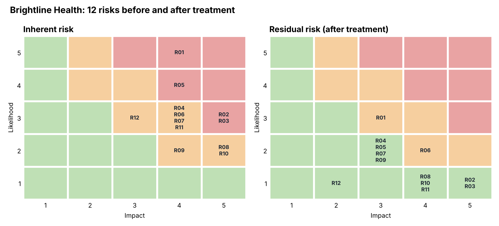

# 02 · Risk Register for a Healthcare SaaS

> Brightline Health is fictional. Risks, scores and outcomes are illustrative.

## 1. Why I built this
Risk registers are how leadership decides where to spend security money.

## 2. What I built
- Asset list: 8 critical and high-value assets with owners (database, S3, API, AWS accounts, Microsoft 365, laptops, CI/CD, PHI vendors).
- Risk register: 12 risk scenarios scored Likelihood × Impact (1-5), each with treatment, owner and residual score. Scores and ratings are formulas ([Risk_Register.xlsx](Risk_Register.xlsx)).
- Heat maps before and after treatment (Excel conditional formatting and the image below).
- One-page [Risk Summary Report](Risk_Summary_Report.md) on the top 3 risks for leadership.

## 3. Explain
A risk register is how leadership decides where to spend limited security money. Scoring inherent risk shows what could go wrong with no controls; scoring residual risk shows what is left after the controls, which is the risk leadership actually accepts.

## 4. What was broken
- **4 High risks:** phishing → Microsoft 365 takeover (score 20), former staff keeping access (16), stolen AWS credentials (15), public S3 bucket exposure (15).
- No register existed before: risks were discussed in meetings but never scored, owned or tracked.

## 5. What was fixed
| Risk | Control added | Inherent → residual |
|---|---|---|
| R01 Phishing / account takeover | MFA number matching, conditional access, forwarding alerts, phishing simulations | 20 → 9 |
| R05 Former staff access | HR-triggered offboarding, quarterly access reviews | 16 → 6 |
| R02 Stolen AWS credentials | MFA on root, SSO roles instead of IAM users, GuardDuty | 15 → 5 |
| R03 Public S3 bucket | Account-level Block Public Access, AWS Config rule | 15 → 5 |
| R11 Breach not reported in 60 days | IR plan, multi-region logging, tabletop test | 12 → 4 |

## 6. Business impact
- Total risk score down **57%** (151 → 65); High risks down from 4 to 0.
- The two biggest PHI breach paths (email takeover and cloud misconfiguration) now have layered controls, reducing the chance of a HIPAA-reportable breach and the cost that comes with one.
- Leadership has one page to decide what to fund next, instead of a list of worries.

## 7. Remediation still open
| Item | Owner | Target |
|---|---|---|
| Decide on residual Medium risks R01 and R06 (accept or fund more controls) | CEO | 2026-12-15 |
| Email security add-on to reduce phishing further | IT Lead | Q1 2027 (if funded) |
| Re-score all risks after the internal audit | GRC | Quarterly |

## 8. Decisions and trade-offs
I recommended accepting medium residual risk on phishing rather than buying every tool, and asked leadership to make that call explicitly.
