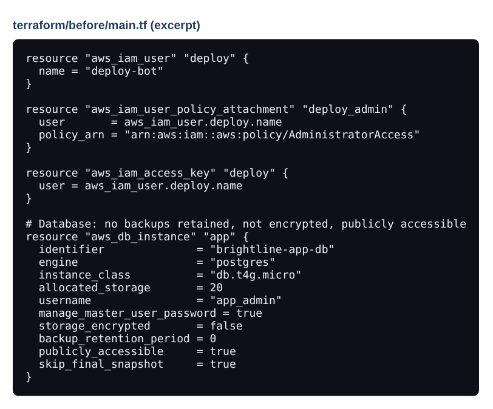
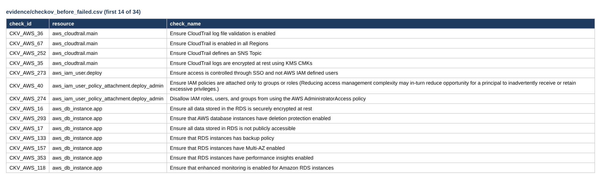
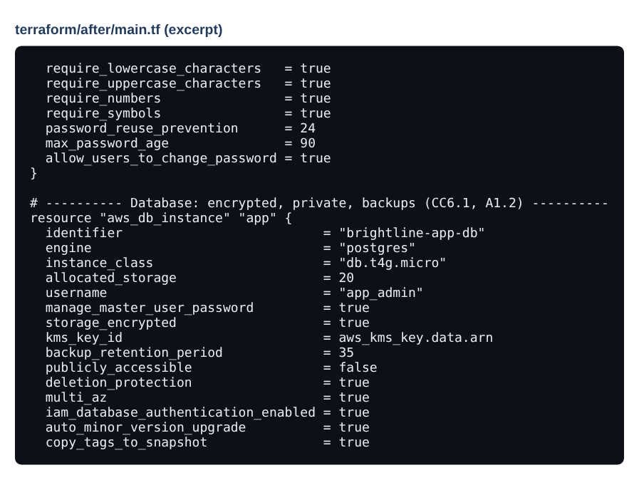
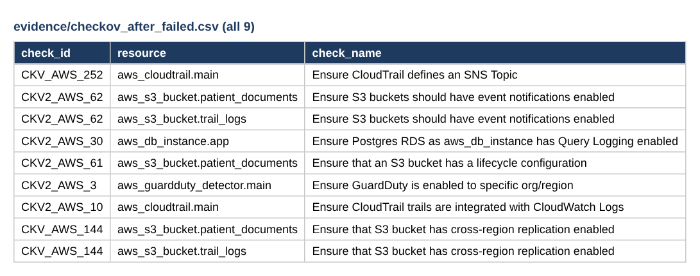
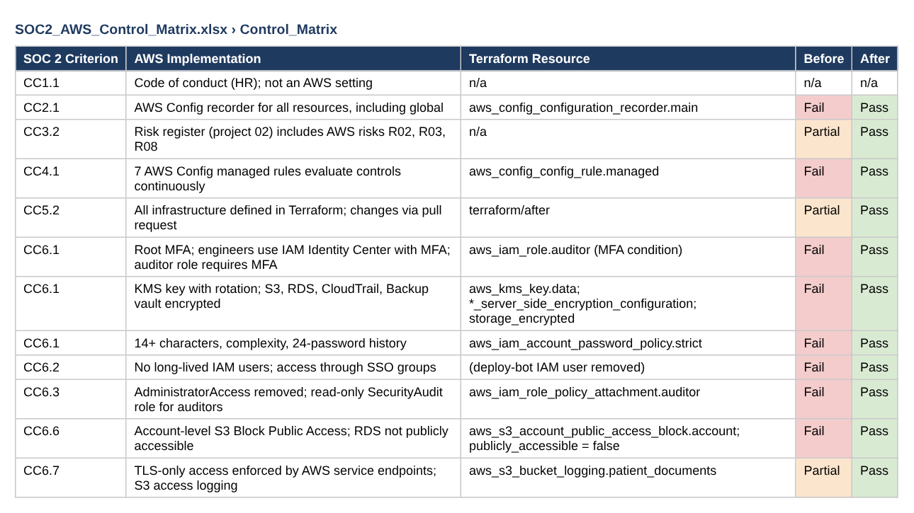

# Evidence: SOC 2 Controls on AWS (Terraform + Checkov)

Insecure baseline → scan → fixed code → re-scan → mapped to SOC 2.

> Screenshots are taken from the files in this repository. Data is fictional or simulated.

## Step 1 · Broken: the original configuration

Public, unencrypted database with no backups; admin IAM user with permanent keys.

## Step 2 · Broken: scan before fixes

Checkov 3.4.3: 34 failed checks, 17 passed.

## Step 3 · Fixed: hardened database code

Encrypted, private, Multi-AZ, 35-day backups, deletion protection.

## Step 4 · Verified: scan after fixes

82 passed, 9 failed; each remaining failure has a fix-or-accept decision.

## Step 5 · Verified: SOC 2 control matrix

Each criterion mapped to the setting, the Terraform resource and the evidence.

