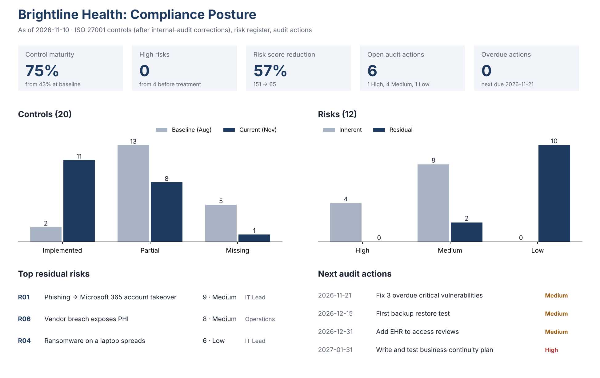

# 06 · Compliance Dashboard

> Brightline Health is fictional. The dashboard combines the outputs of projects 01, 02 and 07.

## 1. Why I built this
Executives need one screen, not twenty spreadsheets.

## 2. What I built
| File | What it is |
|---|---|
| [Compliance_Dashboard.xlsx](Compliance_Dashboard.xlsx) | Dashboard tab (KPI tiles, two native Excel charts, top-risks widget, next-actions widget; all formulas) over three data tabs: Controls, Risks, Actions |
| [dashboard.png](dashboard.png) | Image version for the portfolio and LinkedIn ([render script](render_dashboard_image.py)) |

**KPIs:** control maturity · residual High risks · total risk reduction · open audit actions · overdue actions. Change any status or the as-of date and the dashboard recalculates.

## 3. Explain
Executives and auditors don't read 20-row control matrices. A dashboard answers their three questions in one screen: Are we getting better? What's still risky? What's late? It also forces data discipline: the numbers only work if every control, risk and action has a current status and owner.

## 4. What was broken
- Compliance status lived in three separate spreadsheets, updated at different times; leadership got verbal updates.
- The 90-day self-assessment reported **80% maturity**; the internal audit showed two controls were overstated.
- There was no single list of what was due next, so dates slipped quietly.

## 5. What was fixed
- One workbook links controls, risks and audit actions; KPIs are formulas, so nobody edits the headline numbers by hand.
- Control status now reflects the internal-audit corrections: **75%**, not 80%.
- A "next actions" widget shows the nearest due dates and their severity.

### Key risk indicators (KRIs)
KPIs show what was done; KRIs warn that a risk is getting more likely. The workbook's KRIs tab tracks six, each tied to a risk in the register:

| KRI | Current | Target | Status |
|---|---:|---:|---|
| Critical vulnerabilities past 15-day SLA | 3 | 0 | Red |
| Phishing simulation click rate | 9% | < 5% | Amber |
| Access removals within 5 days | 82% | 100% | Red |
| PHI vendors assessed | 25% | 100% | Red |
| Days since last restore test | never | ≤ 90 | Red |
| Cloud resources missing an Owner tag | 0 | 0 | Green |

## 6. Business impact
- The monthly steering meeting now starts from one screen (about 10 minutes instead of 30 of status updates).
- Honest numbers: the board sees 75%, with the gap to certification readiness spelled out, instead of an optimistic self-assessment.
- Overdue work becomes visible the day it slips.

## 7. Remediation still open
| Item | Owner | Target |
|---|---|---|
| Monthly update of statuses by control owners (process, not a one-off) | GRC | Monthly |
| Add trend history (month-by-month maturity) once 3 months of data exist | GRC | 2027-02 |
| Move data tabs to a shared source (SharePoint list or GRC tool) to avoid copy-paste | IT Lead | 2027-Q1 |

## 8. Decisions and trade-offs
I showed the lower, audit-corrected number: credibility with the board matters more than a good-looking score.
