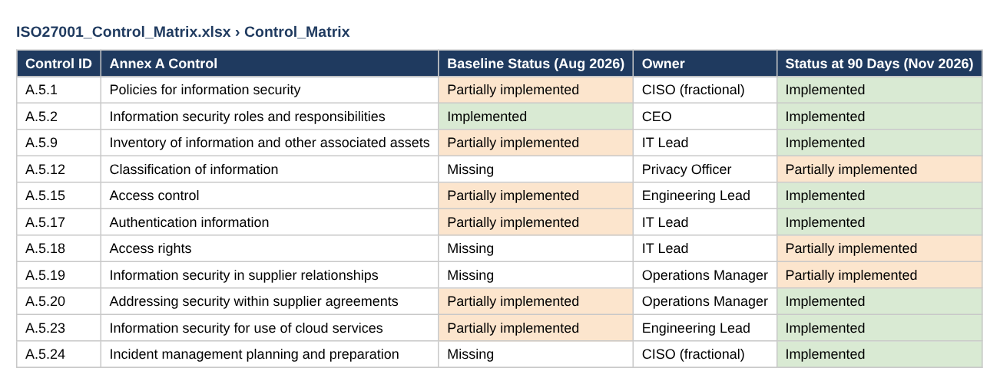
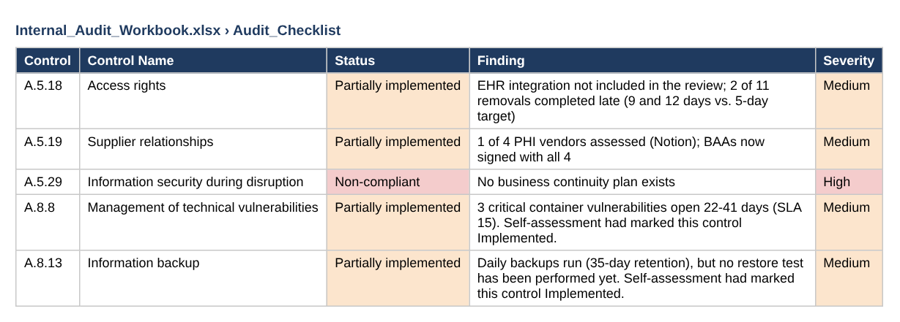
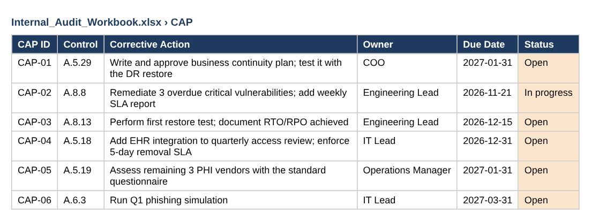
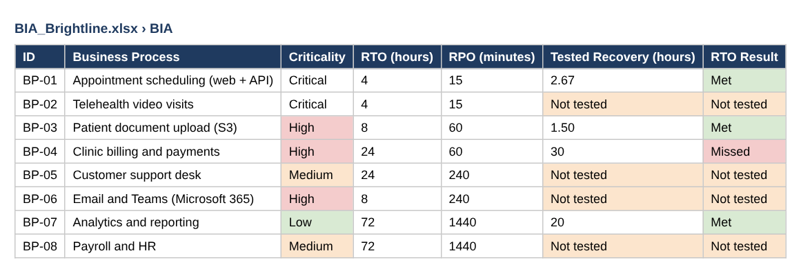
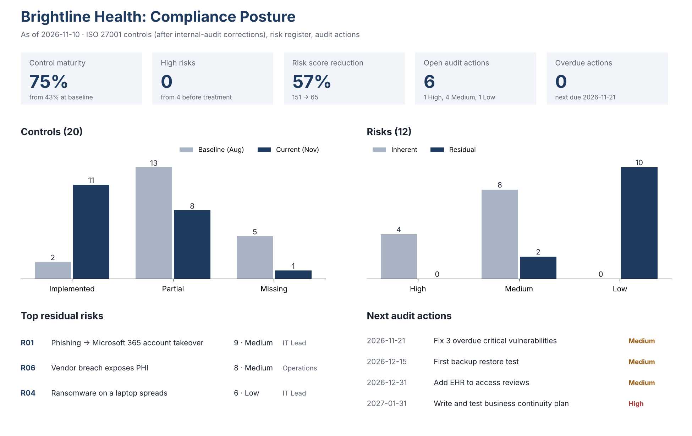
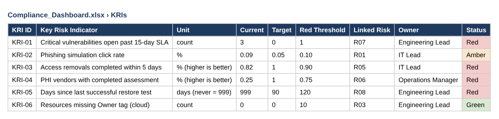

# Evidence: ISO 27001 Program → Internal Audit → Business Continuity

The full loop: baseline gaps, controls fixed, independent audit, findings, and the High finding closed.

> Screenshots are taken from the files in this repository. Data is fictional or simulated.

## Step 1 · Built: baseline control assessment

20 ISO 27001 controls rated in August 2026: 43% maturity.

## Step 2 · Broken: audit findings

Independent test of 10 controls: 1 non-compliant, 4 partially implemented.

## Step 3 · Fixed: corrective action plan

Every finding has an action, owner and due date.

## Step 4 · Fixed: High finding closed: business impact analysis

No BCP was the High finding. The BIA sets recovery targets; the test restore met the target for scheduling.

## Step 5 · Verified: compliance dashboard

Audit-corrected maturity (75%), risks, actions and KRIs on one screen.

## Step 6 · Remediation: key risk indicators still red

What leadership still has to fix, tracked as KRIs.

