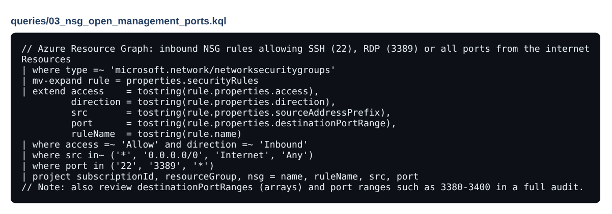
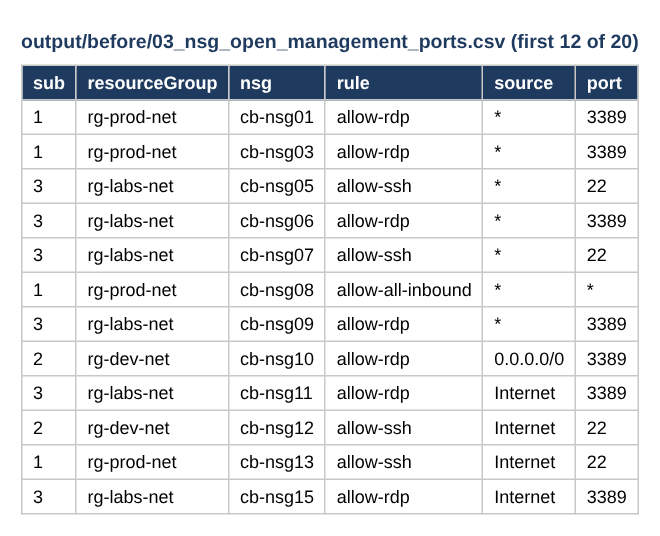
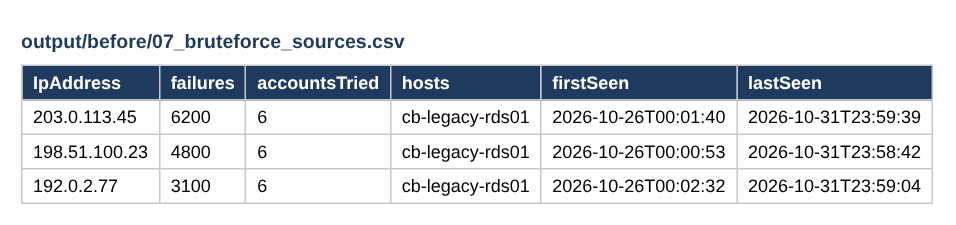
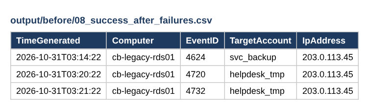
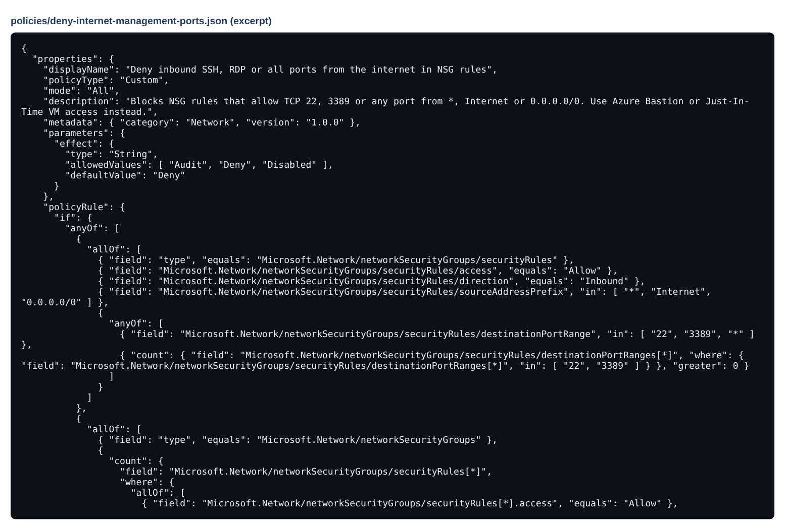
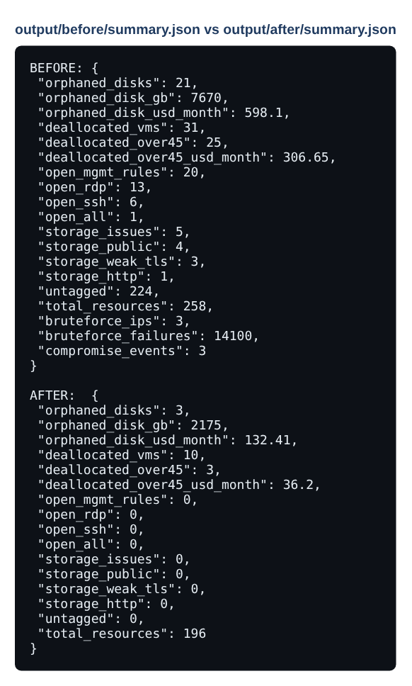
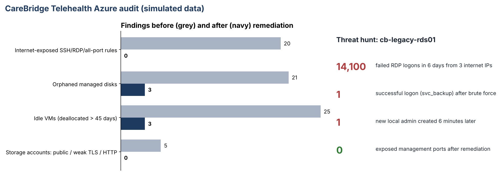

# Evidence: Azure Cloud Governance & Threat Hunt

Inventory → findings → intrusion found → contained → fixed → re-audited → prevented.

> Screenshots are taken from the files in this repository. Data is fictional or simulated.

## Step 1 · Built: Resource Graph query

KQL used to find NSG rules open to the internet (same logic runs offline in scripts/audit.py).

## Step 2 · Broken: exposed management ports

20 rules allow SSH, RDP or all ports from the internet.

## Step 3 · Broken: threat hunt: brute force

14,100 failed RDP logons in 6 days from 3 internet IPs.

## Step 4 · Broken: threat hunt: successful intrusion

Successful logon from the top attacking IP, then a new local admin account 6 minutes later.

## Step 5 · Fixed: preventive policy

Azure Policy that denies new internet-exposed SSH/RDP rules.

## Step 6 · Verified: re-audit after remediation

Audit re-run on the remediated state.

## Step 7 · Verified: before vs after

Findings before and after remediation.

