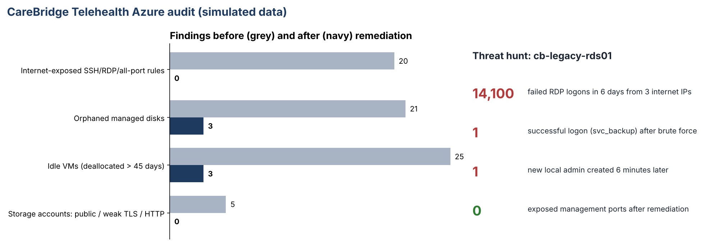

# 08 · Cloud Governance & Threat Hunting Audit (Azure)

**Evidence:** [step-by-step screenshots from build to remediation](EVIDENCE.md)

> **Scenario:** Brightline Health is acquiring **CareBridge Telehealth** (fictional), which runs on 3 Azure subscriptions. Before connecting the two networks, GRC audited CareBridge's Azure estate for cost waste, exposure and signs of compromise.
> **Data is simulated** (generated with a fixed seed so the results are reproducible). The KQL queries, Azure Policy definitions and remediation scripts are written for a real Azure environment; the Python audit runs the same logic offline. Attacker IPs use reserved documentation ranges.

## 1. Why I built this
In an acquisition you inherit the other company's cloud, including its risks and any attacker already inside.

## 2. What I built
| Folder / file | What it is |
|---|---|
| [queries/](queries/) | 8 KQL queries: 5 for Azure Resource Graph (orphaned disks, deallocated VMs, NSG rules open to the internet, storage exposure, missing tags) and 3 for Log Analytics (VM activity, RDP brute force, success-after-failure hunt) |
| [scripts/generate_environment.py](scripts/generate_environment.py) | Builds the simulated environment: 258 resources and 14,503 security events |
| [scripts/audit.py](scripts/audit.py) | Runs the same checks as the KQL on the exported data and writes findings CSVs plus a summary ([output/before](output/before), [output/after](output/after)) |
| [policies/](policies/) | 4 Azure Policy definitions: deny internet-exposed SSH/RDP, deny public or weak-TLS storage, require Owner/ExpirationDate tags on resource groups, inherit those tags to resources |
| [remediation/](remediation/) | 4 Azure CLI scripts (dry run by default; `APPLY=1` to change): snapshot and delete orphaned disks, close management ports, harden storage, decommission approved idle VMs |
| [scripts/simulate_remediation.py](scripts/simulate_remediation.py) | Applies the approved fixes to the simulated data so the audit can be re-run to prove they worked |

**How to run:** `python scripts/generate_environment.py && python scripts/audit.py data/resource_inventory_before.json output/before`.
**On a real tenant:** run the files in `queries/` in Azure Resource Graph Explorer and Log Analytics.

## 3. Explain
In an acquisition, you inherit the other company's cloud: its bills, its open doors and possibly an attacker already inside. This audit does three jobs at once:
- **FinOps:** find resources being paid for but not used.
- **Governance:** find configurations that break policy (internet-exposed admin ports, public storage, no owner).
- **Threat hunting:** check whether the exposed systems have already been attacked successfully.

## 4. What was broken (before)
| Area | Finding |
|---|---|
| Network | **20 NSG rules** open to the internet: 13 RDP (3389), 6 SSH (22), 1 all ports |
| Threat hunt | Legacy server `cb-legacy-rds01` (RDP open to `*`) received **14,100 failed logons** in 6 days from 3 internet IPs. Then: a **successful logon as `svc_backup`** from the top attacking IP at 03:14, and a **new local admin account (`helpdesk_tmp`)** created 6 minutes later. **This is a compromise, not just exposure.** |
| Storage | 5 accounts with issues: 4 allow anonymous blob access (including `cbpatientintake`), 3 allow TLS 1.0/1.1, 1 allows HTTP |
| Cost | **21 orphaned disks (7.7 TB)**, about $598/month; **25 VMs deallocated for more than 45 days**, whose disks cost about $307/month |
| Governance | **224 of 258 resources (87%)** missing an Owner or ExpirationDate tag, so nobody could say who owned the waste |

## 5. What was fixed
**Incident first (same day):**
1. Isolated `cb-legacy-rds01` (NSG deny-all, VM deallocated), took disk snapshots for forensics, and placed it on legal hold.
2. Disabled `svc_backup` and `helpdesk_tmp`, reset all local and service credentials on CareBridge servers, and blocked the 3 IPs.
3. Hunted for the same IPs and accounts across all subscriptions: no other successful logons. Forensic review of the server (simulated) found no access to the patient-intake share. Integration of the two networks was paused until containment was confirmed.

**Then the governance fixes (verified by re-running the audit on the remediated state):**
| Area | Before → after |
|---|---|
| Internet-exposed management rules | 20 → **0** (access moved to Azure Bastion / Just-In-Time) |
| Storage issues | 5 → **0** (public access off, HTTPS only, TLS 1.2) |
| Orphaned disks | 21 → **3** (3 kept by owner request, tagged with an expiry date) |
| Idle VMs > 45 days | 25 → **3** (22 snapshotted and decommissioned with owner sign-off) |
| Resources missing Owner/ExpirationDate | 224 → **0** (tag inheritance policy + remediation task) |

**Prevention:** 4 Azure Policies assigned at the management-group level so these problems can't come back: new internet-exposed SSH/RDP rules and public storage are denied, and every resource group must have an owner and expiry date.

## 6. Business impact
- **Security:** an active intrusion was found and contained **before** CareBridge's network was connected to Brightline's, preventing the attacker from reaching Brightline's PHI.
- **Cost:** about **$736/month (~$8,800/year)** of storage waste removed (illustrative list prices; confirm with the Azure Pricing Calculator; compute savings excluded).
- **Deal terms:** the findings gave Brightline evidence to negotiate remediation costs into the acquisition agreement.
- **Governance:** every resource now has an owner and a review date, so future waste is visible and assigned.

## 7. Remediation still open
| Item | Owner | Target |
|---|---|---|
| Complete forensic report on `cb-legacy-rds01`; confirm with counsel whether any notification duty applies | CISO / Privacy Officer | 2026-12-15 |
| Rebuild the legacy reporting service on a supported, private platform; delete the compromised VM after the legal hold ends | Engineering Lead | 2027-02-01 |
| Onboard CareBridge subscriptions to Microsoft Defender for Cloud and Sentinel; alert on queries 07 and 08 | Security Operations | 2027-01-15 |
| Review the 3 kept disks and 3 kept VMs at their expiry dates | Resource owners | 2026-12-31 / 2027-01-31 |
| Extend the NSG policy to port ranges and `destinationPortRanges` arrays (current version covers the common cases) | Cloud Engineering | 2027-01-31 |

## 8. Decisions and trade-offs
I paused the network integration until containment was confirmed, even though it delayed the deal timeline.

*Inspired by Hamish Dean's [Comprehensive Cloud Governance & Threat Hunting Audit](https://hamishdean.com/comprehensive-cloud-governance-threat-hunting-audit/); this version adds a simulated threat hunt, verified remediation and preventive policies.*
