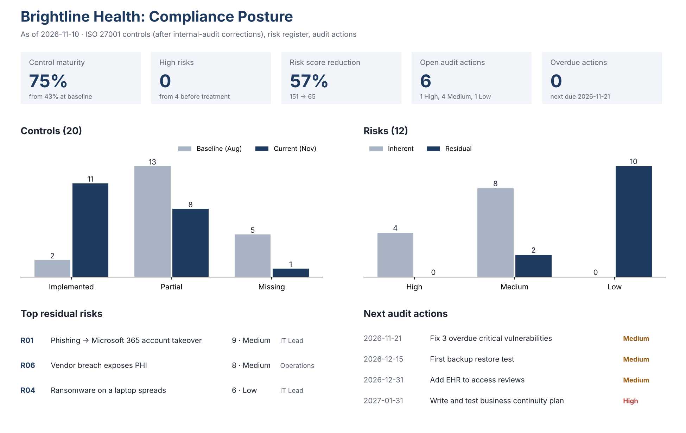
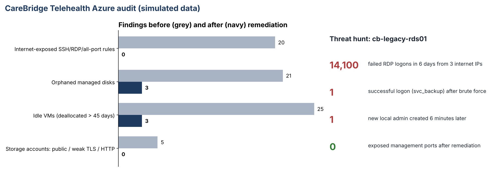
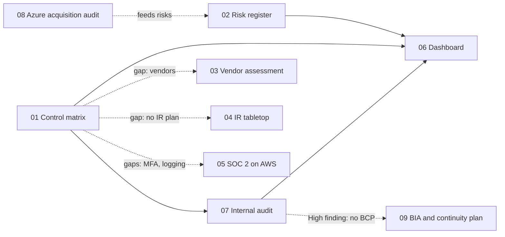

# GRC & Cloud Security Audit Labs

Nine hands-on projects by **Naa Aboagye**, a risk and controls professional with 10 years in audit, controls and SOX assurance. They're built around **Brightline Health**, a fictional 60-person healthcare SaaS company on AWS and Microsoft 365 that is preparing for ISO 27001 and SOC 2 while acquiring a company on Azure.

> All companies and data are fictional or simulated. The one exception is project 03, which assesses a real vendor (Notion) using only its public security documentation.

## How each project is written
Every project is written as a decision story, not a pile of documents:

| Part | Question it answers |
|---|---|
| 1. Why I built this | What business problem or audit finding started it? |
| 2. What I built | The files, tools and how to run them |
| 3. Explain | Why does this matter to the business, in plain language? |
| 4. What was broken | What did the assessment find, with numbers? |
| 5. What was fixed | What changed, and how was the fix verified? |
| 6. Business impact | What did it mean for risk, cost, compliance or revenue? |
| 7. Remediation still open | What's left, who owns it, and by when? |
| 8. Decisions and trade-offs | What I chose not to do, and why |

## Projects

| # | Project | Headline result |
|---|---|---|
| 01 | [ISO 27001 mini compliance program](01-iso27001-compliance-program/) | 20 Annex A controls; maturity 43% → 75% (audit-corrected) |
| 02 | [Risk register](02-risk-register/) | 12 risks; High risks 4 → 0; total risk score down 57% |
| 03 | [Vendor assessment: Notion (real public docs)](03-vendor-assessment-notion/) | 32 questions, 89% score; PHI found on a plan with no HIPAA BAA, fixed |
| 04 | [Incident response plan + tabletop](04-incident-response-tabletop/) | Phishing → account takeover exercise exposed 5 gaps, incl. 23-hour detection |
| 05 | [SOC 2 → AWS control mapping (Terraform + Checkov)](05-soc2-aws-control-mapping/) | Failed security checks 34 → 9; 19 SOC 2 criteria mapped to code and evidence |
| 06 | [Compliance dashboard](06-compliance-dashboard/) | One screen for controls, risks, audit actions and 6 key risk indicators |
| 07 | [Mock internal audit](07-internal-audit/) | 10 controls tested; caught 2 controls the self-assessment overstated |
| 08 | [Azure cloud governance & threat hunting audit](08-azure-cloud-governance-threat-hunt/) | Found an active RDP compromise; 20 exposed ports → 0; ~$8.8k/yr waste removed |
| 09 | [Business impact analysis & continuity plan](09-business-impact-analysis-bcp/) | Closes the audit's High finding; scheduling restore 2h40m vs 4h target |

 

## How the projects connect

## Frameworks and tools
**Frameworks:** ISO/IEC 27001:2022 · ISO 22301-style BIA · SOC 2 (TSC CC1-CC9, A1) · HIPAA Security and Breach Notification Rules · ISO 31000 risk process · CIS-style cloud baselines
**Tools:** Excel (formula-driven workbooks) · Terraform · Checkov · AWS CLI · KQL (Azure Resource Graph, Log Analytics) · Azure Policy · Azure CLI · Python · Mermaid

**Project ideas from:** Artem Polynko, [7 GRC Analyst Hands-On Projects](https://artempolynko.com/blog/7-grc-analyst-hands-on-projects/) (01-07); an IT audit & GRC portfolio checklist shared on LinkedIn (09); Hamish Dean, [Comprehensive Cloud Governance & Threat Hunting Audit](https://hamishdean.com/comprehensive-cloud-governance-threat-hunting-audit/) (08).

## Contact
[LinkedIn](https://www.linkedin.com/in/naaa-aboagye/)
